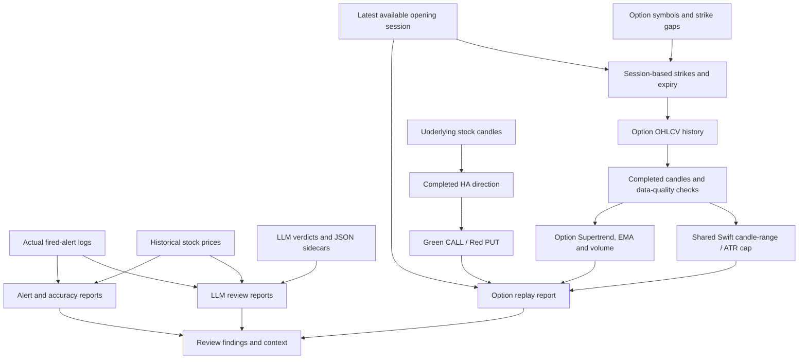

# Report knowledge graph

Start here to understand which reports exist, what produces them, and which code and
configuration give their results meaning. Reuse the linked guides when regenerating a report.
Existing dated HTML files are historical snapshots; they do not automatically reflect later code changes.

## Relationships

## Report families and authoritative guides

| Report family | What it answers | Procedure | Inputs |
|---|---|---|---|
| Alert day report and accuracy | What fired, and what price movement followed? | [Alert report guide](ALERT-REPORT-GUIDE.md) | `[ALERT_FIRED]` logs and subsequent stock bars |
| LLM alert review | Did advisory verdicts agree with alerts and observed outcomes? | [LLM review guide](LLM-REVIEW-REPORT-GUIDE.md) | Fired alerts, review logs/JSON sidecars, optional price verification |
| Option Supertrend replay | Which option signals qualify under the replayed rules? | [Option replay guide](OPTION-VOL-ST-REPORT-GUIDE.md) | Stock opening prices, generated contracts, option bars, stock HA and configuration |

LLM report generation uses [llm_review_report.py](../scripts/llm_review_report.py).
Option replay analysis uses [option_replay_report.py](../scripts/option_replay_report.py), which
renders saved JSON without calling the broker and reuses the existing report style.
The [project context](../.kiro/steering/project-overview.md) explains the shared architecture.

## Existing report snapshots

| Session | Artifact | Family |
|---|---|---|
| 2026-10-09 | [Alert report](alert-report-2026-10-09.html) | Actual alerts |
| 2026-10-09 | [Accuracy report](alert-accuracy-report-2026-10-09.html) | Price-outcome verification |
| 2026-10-15 | [Accuracy report](alert-accuracy-report-2026-10-15.html) | Price-outcome verification |
| 2026-10-12 | [LLM review](llm-review-report-2026-10-12.html) | Advisory review |
| 2026-10-13 | [LLM review](llm-review-report-2026-10-13.html) | Advisory review |
| 2026-10-14 | [LLM review](llm-review-report-2026-10-14.html) | Advisory review |
| 2026-10-16 | [Option replay](option-vol-st-replay-2026-10-16.html) | Historical detection |
| 2026-10-16 | [Updated option analysis, generated 2026-10-18](option-vol-st-replay-2026-10-16-analysis-2026-10-18.html) | Fresh replay with HA, ATR cap and quality diagnostics |

The original eight snapshots predate the 2026-10-18 HA, data-quality/recovery and shared ATR-cap
changes. The updated analysis uses fresh data captured after a clean build and script-based app
restart: 96 signals, 45 fired contracts, 121 contracts with session data, across 11 underlyings.
Companion artifacts: [exact replay JSON](option-vol-st-replay-2026-10-16-analysis-2026-10-18.json),
[signal CSV](option-vol-st-replay-2026-10-16-analysis-2026-10-18.csv), and
[provenance metadata](option-vol-st-replay-2026-10-16-analysis-2026-10-18.metadata.json).

## Option replay: concepts linked to implementation

| Concept | Implementation | Configuration / report interpretation |
|---|---|---|
| Session selection | [OptionsController](../src/main/java/com/trading/option/OptionsController.java) | Latest actual 09:30 ET opening date in returned stock history; `date` is replay date, `requestDate` is request date, `previousSession` indicates fallback |
| Contract universe | [OptionUniverseLoader](../src/main/java/com/trading/option/OptionUniverseLoader.java), [option-tickers.txt](../src/main/resources/option-tickers.txt) | Shared `[strike-gap=...]` sections, `[default]`, optional per-symbol overrides; duplicates keep the first entry |
| Strike and expiry generation | [OptionContractService](../src/main/java/com/trading/option/OptionContractService.java), [OccSymbolGenerator](../src/main/java/com/trading/option/OccSymbolGenerator.java) | Replay fixes strikes at the stock's session OPEN and resolves expiry relative to that session date |
| Option history and recovery | [OptionBarDataManager](../src/main/java/com/trading/option/OptionBarDataManager.java), [MarketDataService](../src/main/java/com/trading/service/MarketDataService.java) | Up to 1200 option bars; live/inspection recovery permits one extra fetch per symbol/timeframe/minute per app instance |
| Stock history and recovery | [BarDataManager](../src/main/java/com/trading/service/BarDataManager.java) | HA recovery uses up to 1650 stock source bars; targeted refresh preserves diagnostic cache fallback |
| Candle validity | [BarQuality](../src/main/java/com/trading/service/BarQuality.java) | Timestamp completion, freshness, actual warmup, OHLCV, ordering/duplicates and recent-session gaps; synthetic buckets need complete source candles |
| CALL versus PUT | [OptionHaDirectionFilter](../src/main/java/com/trading/option/OptionHaDirectionFilter.java), [HeikinAshiCalculator](../src/main/java/com/trading/indicator/HeikinAshiCalculator.java) | Underlying STOCK HA: green permits CALL, red permits PUT; doji/unusable data blocks both. Color only, with no candle-strength requirement |
| Option signal legs | [OptionVolumeStAlert](../src/main/java/com/trading/option/OptionVolumeStAlert.java) | OPTION candles: Supertrend UP/rising, EMA close/stack, optional volume and higher-timeframe ST confirmation |
| Large candle rejection | [CandleRangeAtrFilter](../src/main/java/com/trading/indicator/CandleRangeAtrFilter.java), [SwiftTrendDetector](../src/main/java/com/trading/indicator/SwiftTrendDetector.java) | Shared Swift calculation: completed OPTION range / current Wilder ATR; four-decimal comparison; reject strictly above threshold |
| Live delivery | [AlertEngine](../src/main/java/com/trading/alert/AlertEngine.java), [MarketHoursGuard](../src/main/java/com/trading/service/MarketHoursGuard.java) | Shared configured market-hours gate and continuous-match deduplication; distinct from replay cooldown |

Configuration source: [application.yml](../src/main/resources/application.yml), with types/defaults
in [AppProperties](../src/main/java/com/trading/config/AppProperties.java). Under
`app.alerts.option-vol-st`, inspect `ha-direction-enabled`, `ha-timeframe`,
`large-candle-filter-enabled`, `max-candle-atr`, `three-min-st-enabled`, and `bar-quality`.
Read current values rather than assuming an old report's configuration is still active.

## Reading empty or rejected results

| Response field | Meaning |
|---|---|
| `date: null` / row `note` | No usable opening session resolved from available stock history |
| `contractsWithSessionData: 0` | No usable option session bars; zero signals is not evidence that the strategy conditions failed |
| `dataQualityRejections` | Counts of skipped evaluations for warmup, freshness, gap, OHLCV, duplicate or HA-availability failures |
| `largeCandleRejections` | ATR-cap rejection counts after quality/HA/cooldown checks and before the remaining option conditions; not a data error |
| Inspection `haColor`, `haDirectionOk` | Underlying HA side selection |
| Inspection `candleRangeAtr`, `candleSizeOk`, `note` | Option candle-size metric, decision and explanation |

Replay freshness uses historical evaluation time. It never injects live candles into a historical
step. Missing or expired-contract history cannot be reconstructed by inventing candles.

## Validation links

- [Replay regressions](../src/test/java/com/trading/option/OptionVolumeStReplayTest.java): historical timing, cooldown, HA sides, gap/duplicate causality and ATR toggle behavior.
- [Session selection tests](../src/test/java/com/trading/option/OptionsReplaySessionTest.java): previous sessions, expiry and missing-history handling.
- [Signal recovery tests](../src/test/java/com/trading/option/OptionSignalRecoveryTest.java): healthy signals, recovery, completed prices and live/inspection ATR parity.
- [HA tests](../src/test/java/com/trading/option/OptionHaDirectionFilterTest.java): colors, closure, freshness, warmup and synthetic completeness.
- [Quality tests](../src/test/java/com/trading/service/BarQualityTest.java) and [ATR-cap tests](../src/test/java/com/trading/indicator/CandleRangeAtrFilterTest.java): shared validation and threshold semantics.

Latest recorded code validation on 2026-10-18: **116 passing tests**. This is regression evidence,
not broker-backed verification or proof of profitable signals. This documentation update does
not regenerate reports or execute trading.

## Maintenance

1. Update this inventory when adding report snapshots; link each to its guide and session date.
2. Capture the code revision, effective configuration, selected session and data coverage when regenerating reports.
3. Keep procedures in the existing guides; keep this file as the relationship/index layer.
4. Preserve historical HTML snapshots and distinguish replay detections from actual delivered alerts.
5. Link findings into the existing Obsidian daily log and Backtest Log; keep the report procedures here as the source.

## Stock/side option alert grouping (2026-10-18)

- [Grouping coordinator](../src/main/java/com/trading/option/OptionSignalGrouping.java) collects unthrottled replay candidates before applying one cooldown per underlying + CALL/PUT side.
- [Regression coverage](../src/test/java/com/trading/option/OptionSignalGroupingTest.java) verifies grouped strikes, changed-strike suppression, exact cooldown boundary, independent sides/stocks and delivery-attempt semantics.
- Live groups retain every qualifying strike in numeric order. No ranking or preferred contract is implemented; user explicitly deferred ranking pending discussion.
- Existing dated reports preserve the old per-contract counting. New API `totalSignals` counts groups and `totalContractSignals` counts retained contract candidates; the renderer identifies both scopes.
- Captured pre-fix replay: 96 contract signals form 69 simultaneous stock/side groups. This is descriptive, not the corrected replay result, because the prior capture already applied per-contract cooldown.
- Quote spreads and sizes are absent from captured history; activity and proximity alone do not establish a best contract. See the existing option report guide and Obsidian daily log for semantics and limitations.

Runtime verification: [exact grouped replay JSON](option-vol-st-grouping-verification-2026-10-18.json)
for session 2026-10-16 returned **62 stock/side groups, 101 retained contract candidates, 275 raw qualifying candidates**.
Effective cooldown was **10 minutes**, an intentional user setting; preserved. Verified every consecutive
same-stock/side group respects that interval, group/candidate totals reconcile, and `rankingApplied=false`.
These counts differ from the older 30-minute per-contract snapshot and are not a like-for-like reduction metric.

## Grouped replay report generated 2026-10-18

- [Grouped option analysis, session 2026-10-16](option-vol-st-replay-2026-10-16-grouped-2026-10-18.html): 62 stock/side alerts (6 CALL, 56 PUT), 101 candidates across 40 contracts; configured 10-minute cooldown, no ranking.
- [Source JSON](option-vol-st-replay-2026-10-16-grouped-2026-10-18.json), [candidate CSV](option-vol-st-replay-2026-10-16-grouped-2026-10-18.csv), [provenance](option-vol-st-replay-2026-10-16-grouped-2026-10-18.metadata.json).
- Reuses verified capture at 21:13:06 EDT rather than fetching history again. 121 contracts with data; all 11 symbols covered. Three ATR rejects, 9249 quality rejects, 98 stock/side evaluation groups suppressed by cooldown. Counts describe detections, not fills/P&L.
- Overview, side totals and hourly chart count groups; detailed contract tables/CSV count candidates. Group table lists every qualifying strike and premium at historical evaluation time. Source hash at capture unavailable, explicitly labeled in provenance. Existing snapshots preserved.

## Dynamic nearest expiry and last completed session

- [Option contract service](../src/main/java/com/trading/option/OptionContractService.java): shared live/replay nearest-listed resolver, daily success cache and one-minute failure throttle. DTE config removed.
- [Webull adapter](../src/main/java/com/trading/webull/WebullV3Client.java): paginated metadata, exact expiry queries recover last-session contracts omitted from general listings. No date/expiry guessing from missing bars.
- [Expiry tests](../src/test/java/com/trading/option/OptionExpiryDiscoveryTest.java), [metadata tests](../src/test/java/com/trading/webull/OptionExpirationMetadataTest.java), [session tests](../src/test/java/com/trading/option/OptionsReplaySessionTest.java): nearest actual dates, historical recovery, isolation/caching, pagination, failures and intraday last-completed-session cutoff.
- Live broker checks: AAPL 2026-10-19 expiry, 11 contracts loaded. Last-session SPY reference/expiry both 2026-10-16. Full clean build: 116 tests pass. Earlier reports preserve pre-discovery behavior.
- See [report guide](OPTION-VOL-ST-REPORT-GUIDE.md#dynamic-expiry-and-last-session-replay-2026-10-18) for exact-date API findings, failure behavior and scope. Ranking remains deferred and the user's 10-minute cooldown is preserved.
